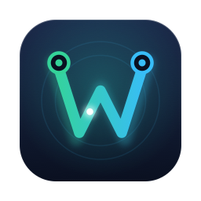

# Wirest

<p align="center"></p>

A one-click WireGuard VPN app for macOS, written in Rust ([egui/eframe](https://github.com/emilk/egui)).
Add your VPN once, then connect from the window or the menu bar. Everything it needs is built from
source and bundled inside `Wirest.app` — no Homebrew, no Go.

## Quick start

```sh
./run.sh            # installs what's missing, builds dist/Wirest.app and opens it
./run.sh --install  # same, and copies it to /Applications
```

The only thing you may be asked for is Xcode Command Line Tools (`run.sh` opens Apple's installer if
they are missing). Rust is installed via [rustup](https://rustup.rs) if absent. The first build takes
a couple of minutes; later runs reuse the cache in `.deps/`.

## Features

- One big **Connect** button; the full config details live behind **Advanced**
- Menu-bar icon with Connect / Disconnect, like Tailscale; closing the window keeps Wirest running
- No password prompts after the first connect (see *How it works*)
- Add a VPN by dropping in a `.conf` file, picking one, or pasting the text
- One VPN at a time: connecting to another switches over
- Live status: handshake and data received / sent
- Advanced view: tunnel list, editor with validation, key generation, log

## Bundled tools

`scripts/deps.sh` downloads pinned, checksum-verified sources and builds into `.deps/out/bin`,
which `bundle.sh` copies to `Wirest.app/Contents/Resources/bin`:

| Tool | Source | Why |
| --- | --- | --- |
| `wg`, `wg-quick` | [wireguard-tools](https://git.zx2c4.com/wireguard-tools/) 1.0.20250521 (C) | configure interfaces |
| `boringtun-cli` | [BoringTun](https://github.com/cloudflare/boringtun) 0.6.0 (Rust, `cargo install`) | userspace WireGuard, replaces `wireguard-go` |
| `bash` | GNU bash 5.3 | `wg-quick` needs bash ≥ 4; macOS ships 3.2 |

`wg-quick` launches `wireguard-go` from its own directory; a two-line shim with that name starts
`boringtun-cli --disable-drop-privileges` instead. If no bundled tools are found, Wirest falls back to
a Homebrew `wireguard-tools` install.

Note: bash and wireguard-tools are GPL; if you redistribute `Wirest.app`, include their sources.

## How it works

Your configs live in `~/Library/Application Support/Wirest/tunnels/<name>.conf` (dir `0700`,
files `0600`). The file name is the tunnel name, so it must be a valid interface name
(1–15 chars, `[A-Za-z0-9_=+.-]`).

Bringing a tunnel up needs root. Like Tailscale's system extension, Wirest installs a small
**helper** the first time you connect — that is the only password prompt:

- The helper is the Wirest binary itself, run as a root LaunchDaemon
  (`com.github.havban.wirest.helper`), with its own root-owned copy of the tools in
  `/Library/Application Support/Wirest/bin`.
- The app talks to it over `/var/run/wirest.sock` (owner `root:staff`, mode `0660`), sending the
  config to connect. The helper refuses configs with `PreUp`/`PostUp`/`PreDown`/`PostDown`
  scripts, since those would run as root.
- The helper is reinstalled automatically when the app is updated. Remove it from
  **Advanced → Remove helper…**, or `Wirest.app/Contents/MacOS/wirest --uninstall-helper`.

## Troubleshooting

- **"WireGuard tools not found"** — run `./run.sh` (or `./scripts/deps.sh`) and relaunch.
- Helper log: `/var/log/wirest-helper.log`. BoringTun log: `/tmp/boringtun.out`.
- Reinstall the helper from a terminal: `Wirest.app/Contents/MacOS/wirest --install-helper`.
- Script hooks (`PostUp` etc.) in a config aren't supported; remove them in **Advanced → Edit**.

## Tests

```sh
cargo test
```
